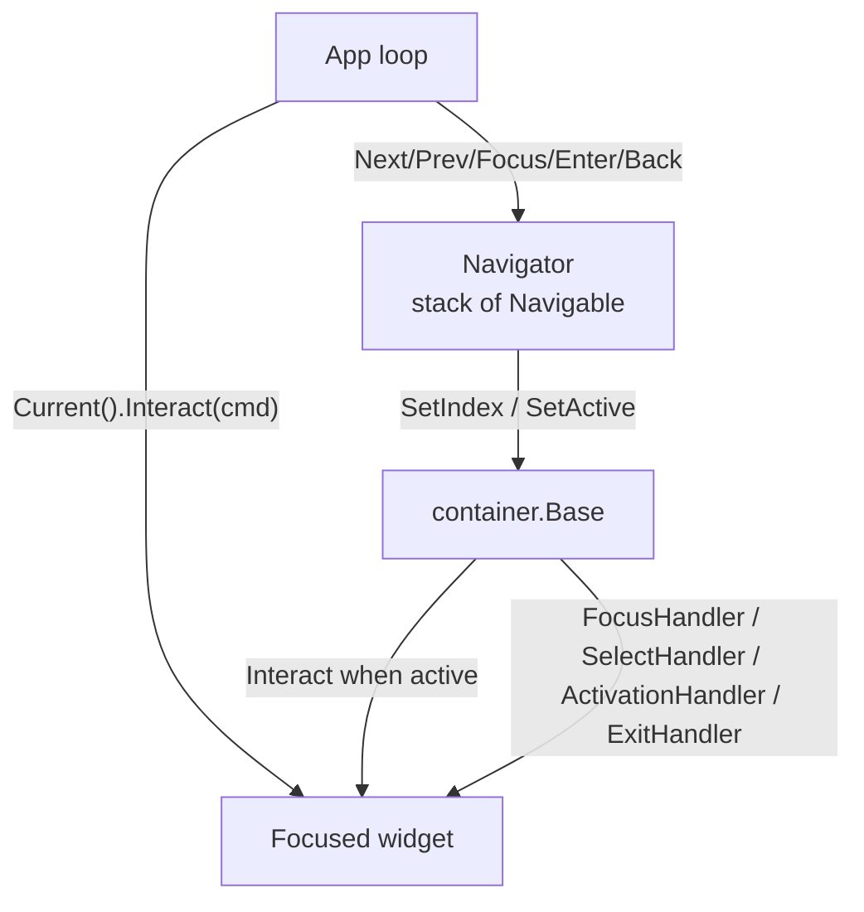

---
aliases:
  - "Navigation and input"
  - "Navigator"
tags:
  - tinygui
  - architecture
type: reference
created: 2026-11-10
updated: 2026-11-10
revision: b140156
---

# Navigation and input

Part of [[architecture]]. Sources at `b140156`.

## Commands

`UserCommand` is a `byte` enum (`widget.go:4-31`): navigation (`UP DOWN LEFT RIGHT NEXT PREV ENTER ESC BACK`), edit/storage verbs (`DEL RESET SAVE LOAD`), long-press variants (`LONG_UP` … `LONG_RESET`), `IDLE` for timeouts and `USER = 64` as the first app-defined code. No widget handles `DEL`, `RESET`, `SAVE`, `LOAD`, `LONG_LEFT/RIGHT/ENTER/ESC/BACK/DEL/RESET` (grep of `widget/` and `container/`). There is no pointer/touch or encoder-delta type; an encoder maps to `UP/DOWN` or `NEXT/PREV` per detent.

## Two navigation layers

### Navigator (`navigator.go`)

- Holds a fixed stack of up to `MaxNavDepth` (8) `Navigable`, root first; `NewNavigator(nil)` panics. `Enter` into a container deeper than that is refused (returns false).
- `Next/Prev` move to the next selectable child of the top container, skipping widgets whose `CanSelect()` or `Enabled()` is false (`:77-99`, `:269-322`). No wrap-around: at the ends they return false.
- `Enter` selects the first selectable child if none, activates it, and pushes it when it is itself `Navigable` (descending into a sub-container); otherwise emits `Activated` (`:121-144`).
- `Back` deactivates the top container; if it was not active, pops one level (`:147-164`). The root is never popped.
- Observers get `FocusChanged`, `Activated`, `Deactivated` with the `Path`. `Path()` and the events' `Path` are the navigator's own buffer, valid until the next navigation: navigating never allocates (`TestNavigatorNavigatesWithoutAllocating`; the old fresh slice per event was 22 allocations for a short focus/enter/back sequence).
- `Walk` traverses the whole tree depth-first with paths built in a fixed buffer (valid during the callback); containers nested deeper than `MaxNavDepth` are not descended into.

### Pages (`container/pages.go`)

An app with many pages hands them to `container.Pages` as `PageSpec{Name, Build}`: a page is built the first time it is shown, at most `PagesConfig.Keep` stay built (the least recently shown is released, `OnRelease` lets the app drop its references), and `Back` returns through a bounded `History` of the pages shown before, rebuilding released ones. Show, Back and Draw allocate nothing in `Pages`; building is the page's own work. State that must outlive a page (sensor history, logs, simulations) belongs in models the builders reference, not in the page. Tests: `TestPagesBuildLazilyAndKeepABoundedNumber`, `TestPagesBackThroughABoundedHistory`, `TestPagesNavigateWithoutAllocating`. The Tufty showcase keeps 3 of 14 pages built: live heap after GC 127–129 KB → 100 KB on the badge.

### Container activation (`container/base.go`)

- `index` (-1 = none) and `active` (selected child receives input) (`:15-16`).
- `SetIndex` deselects every child and selects the target, firing `SelectHandler` and focus hooks (`:174-192`); this is O(children) per focus move.
- `SetActive` toggles `ActivationHandler` and `ExitHandler` on the old/new child (`:200-232`).
- `Interact` while inactive: `PREV/NEXT` move focus, `ENTER` activates, others fall to `WidgetBase.Interact` (only `ESC` handled) (`:267-290`). While active: forwards to the selected child (`:166-170`).
- `IDLE` + elapsed `Timeout` (default 10 s, `:105`) clears the selection (`:260-265`). `lastTime` uses `time.Now()` on every non-idle command (`:160`).

### Selectors

`widget.InteractiveSelector[T]` is the shared index-over-items helper: wraps around, optional external `*int` binding, change callback (`widget/interactive_selector.go:6-168`). Used by `InteractiveLabelChoice`, `InteractiveIconChoice`, `InteractiveWidgetChoice` and `container.ScrollChoice` (`container/choice.go:62-68`), which also auto-scrolls the focused child into view (`container/choice.go:125-158`).

## Input sources

| Source | API | Source lines | Notes |
|---|---|---|---|
| GPIO button | `PeekButton(pin) time.Duration` | `ui.go:12-20` | blocks until release: sleeps 10 ms then 1 ms polls, services the watchdog; the caller maps duration to `UserCommand` |
| GPIO button (examples) | app-local `buttonTracker` | `examples/choice/main.go:39-78` | non-blocking edge detector, short/long/ultra by duration on release; no debounce beyond the 150 ms short threshold (which still returns `eventShort` below it, `:73-74`) |
| Line protocol | `CommandStreamMux` over `io.Reader` | `mux.go:11-103` | reads 1 byte per `Read` (`:22`), splits on `\r`/`\n`, dispatches `cmd arg` to a `map[string]func([]byte)`; `string(line)` for the map key (`:90-93`) #verify whether TinyGo elides that allocation for map lookups |
| Serial | `SerialReader` (`io.Reader` over `Buffered()/ReadByte()`) | `serial_reader.go:9-31` | non-blocking: returns 0 bytes when nothing is buffered, so `CommandStreamMux.Run` spins with `runtime.Gosched()` (`mux.go:30-33`); breaks the build on classic ESP32: [[t-0001-m5stickc-examples-build]] |
| Duration editing | `DurationAdd/DurationSub` | `ui.go:24-36` | step scaled to the value's decimal magnitude |

## Observations

- Mapping from buttons to navigation is duplicated per app and differs between the two examples (compare `examples/choice/main.go:194-243` with `examples/gauge/main.go:240-283`); a library-level input adapter (buttons/encoder → commands → navigator) is missing.
- Focus moves never request a redraw; the app's fixed-rate full redraw hides that.
