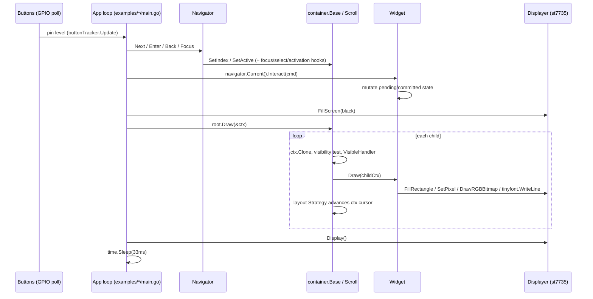

---
aliases:
  - "Render path"
  - "Frame loop"
tags:
  - tinygui
  - architecture
type: reference
created: 2026-11-10
updated: 2026-11-10
revision: b140156
---

# Render path

How one input becomes pixels, at `b140156`. Part of [[architecture]].

The library has no main loop, event queue or frame scheduler. The application owns the loop; both examples use the same shape (`examples/choice/main.go:191-248`, `examples/gauge/main.go:237-287`): poll buttons, call navigator or widget methods, redraw everything, sleep 33 ms.

## Steps with sources

1. **Input sampling.** The app polls pins each iteration and classifies press length on release (`examples/choice/main.go:51-78`). The library offers `PeekButton`, which blocks until release and services the watchdog (`ui.go:12-20`); the examples do not use it.
2. **Command routing.** Two routes coexist:
   - *Navigator route*: `Navigator.Next/Prev/Focus/Enter/Back` change selection and activation on the container at the top of its stack (`navigator.go:77-164`).
   - *Direct route*: the app calls `navigator.Current().Interact(cmd)` itself (`examples/choice/main.go:197-199`). `Base.Interact` forwards a command to the selected child only when the container is active (`container/base.go:156-171`); otherwise it handles `PREV/NEXT/ENTER` (`container/base.go:267-290`).
   The navigator never calls `Interact`; translating buttons to `Navigator` calls versus `UserCommand`s is left to each app. Details: [[navigation-and-input]].
3. **State change.** Editors change a pending value on `UP/DOWN/LEFT/RIGHT` and write it back on `ENTER` (`widget/interactive_label.go:82-115`, `widget/interactive_gauge.go:106-139`). Nothing is marked dirty.
4. **Clear.** The app clears the whole screen every frame (`examples/choice/main.go:186`). On the ST7735 this is a full-screen SPI fill because the driver is unbuffered: `Display()` returns nil without doing anything (drivers v0.31.0 `st7735/st7735.go:233-235`).
5. **Draw.** `Base.Draw` clones a context sized to the container minus margins, sets the cursor to margin+padding, then for each child: visibility test, `VisibleHandler` on change, `Draw`, layout step (`container/base.go:124-153`). `Scroll.Draw` does the same through an `offsetContext` that subtracts the scroll offset from `DisplayPos` (`container/scroll.go:66-75`, `:144-161`).
6. **Widget draw.** Widgets read bound values and paint directly to the displayer at absolute coordinates: rectangles through `RectangleDisplayer` when available (`widget/gauge.go:74-88`), text through `tinyfont.WriteLine` (`widget/label.go:36`), bitmaps through `BitmapDisplayer` (`widget/bitmap.go:42-58`), PNG icons decoded on every draw (`widget/icon.go:13-18` → `drawing.go:58-76`).
7. **Flush.** The app calls `display.Display()` (`examples/choice/main.go:188`); a no-op on unbuffered SPI panels, a full buffer transfer on buffered ones (e.g. SSD1306).

## Consequences

- Every frame repaints every visible pixel even when nothing changed; on an unbuffered panel the clear-then-draw sequence is visible as flicker #verify (needs the device: [[discovery]]).
- Cost per frame grows with the widget count and area, not with what changed. Measurements: [[baseline]].
- Widgets can paint outside their context: no clip rectangle is passed or enforced (`context.go:17-27` has no clip API).
- Layout runs every frame inside `Draw`, interleaved with painting; there is no separate measure/arrange pass.
