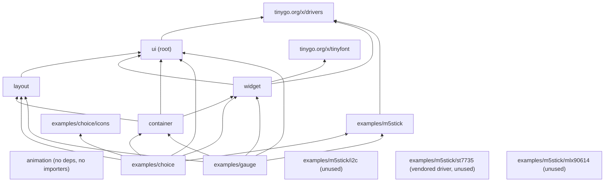

---
aliases:
  - "Topology"
  - "Dependency graph"
  - "Build tags"
tags:
  - tinygui
  - architecture
  - build
type: reference
created: 2026-11-10
updated: 2026-11-10
revision: b140156
---

# Topology

Packages, build tags, external modules and the drivers TinyGUI binds to, at `b140156`. Part of [[architecture]].

## Package dependency graph

Arrows point from importer to imported package (non-test imports, from `grep` of import lines; command in [[baseline]]).

- `container` depends on `widget` only for `ScrollChoice` (`container/choice.go:6`); everything else in `container` needs only `ui` and `layout`.
- `examples/m5stick/{i2c,st7735,mlx90614}` are not imported by anything: `cfg_m5stickc.go` uses the upstream `drivers/i2csoft` and `drivers/st7735` and leaves the vendored import commented out (`examples/m5stick/cfg_m5stickc.go:8-12`).

## External modules (`go.mod`)

| Module | Version | Used for |
|---|---|---|
| `tinygo.org/x/drivers` | v0.31.0 | `drivers.Displayer` (the core display contract, `context.go:18`), `image/png` streaming decoder (`drawing.go:8`), `st7735`, `axp192`, `i2csoft` in examples |
| `tinygo.org/x/tinyfont` | v0.6.0 | all text (`widget/label.go:36`); default font `TomThumb` (ASCII + Latin-1 up to U+00EB; no `▲ ▼ –`) |
| `github.com/stretchr/testify` | v1.9.0 | tests only |
| `machine`, `device` | TinyGo built-ins | GPIO, SPI, I2C, watchdog, `device.Asm` in vendored soft-I2C |

`go.mod` declares `go 1.23.4`; the installed toolchain is Go 1.27.2 / TinyGo 0.43.0 ([[baseline]]).

## Display contract

The minimum a display must implement is `drivers.Displayer`: `Size`, `SetPixel`, `Display` (drivers v0.31.0 `displayer.go:5-14`). Faster paths are optional and discovered by type assertion:

| Interface | Methods | Used by |
|---|---|---|
| `RectangleDisplayer` (`drawing.go:21-25`) | `FillRectangle`, `FillRectangleWithBuffer`, `FillScreen` | gauges, toggle (`FillRectangle` only) |
| `BitmapDisplayer` (`drawing.go:11-14`) | `DrawRGBBitmap([]uint16)`, `DrawRGBBitmap8` | `Bitmap16/8`, `Icon` |
| `LineDisplayer` (`drawing.go:16-19`) | `DrawFastHLine`, `DrawFastVLine` | nothing: `HLine/VLine` always use `SetPixel` (`drawing.go:35-50`) |
| `ui.Displayer` (`drawing.go:27-32`) | all of the above + `drivers.Displayer` | the examples' `configureDisplay` return type |

Upstream `st7735.Device` in drivers v0.31.0 lacks `DrawRGBBitmap([]uint16)` and has pointer receivers, so neither `st7735.Device` nor `*st7735.Device` satisfies `ui.Displayer`; the vendored copy in `examples/m5stick/st7735` does have `DrawRGBBitmap` (`examples/m5stick/st7735/st7735.go:316`). See [[t-0001-m5stickc-examples-build]].

## Build tags and per-target files

| File | Constraint | Content |
|---|---|---|
| `ui.go` | `stm32 \|\| rp2040 \|\| esp32 \|\| esp32c3 \|\| nrf \|\| sam \|\| teensy \|\| fe310 \|\| hid \|\| xiao` | `PeekButton` (needs `machine`), duration helpers |
| `serial_reader.go` | same list without `xiao` | `SerialReader` over `machine.Serialer` |
| `serial_reader_stub.go` | negation of the above | no-op `SerialReader` with a local `serialer` interface |
| `watchdog_rp2040.go` | `rp2040` | feeds `machine.Watchdog` |
| `watchdog_esp32.go` | `esp32 \|\| esp32c3` | no-op |
| `watchdog_stub.go` | `!(esp32 \|\| esp32c3 \|\| rp2040)` | no-op |
| `cmd/i2cscan/main.go` | MCU list as `serial_reader.go` | I2C scanner |
| `examples/choice`, `examples/gauge` | `m5stickc` | demos |
| `examples/m5stick/cfg_m5stickc.go` | `tinygo \|\| m5stickc` | M5StickC pins, power, display |
| `examples/m5stick/i2c/i2csoft_esp32.go` | `esp32` | busy-wait `nop` delay |

Watch out for:
- Tag lists hard-code chip families. `ui.go` and `serial_reader.go` differ (`xiao`), and a target outside the list silently gets the stub `SerialReader` and loses `PeekButton`: `tinygo info -target=xiao-esp32s3` reports tags `xtensa … esp32s3 esp … serial.usb tinygo.unicore` (no `esp32`). TinyGo already exposes `serial.usb` / `serial.uart` tags (`m5stick-c` has `serial.uart`), which describe the capability directly.
- On host builds (`go test`), the root package compiles without `ui.go`, so `PeekButton` and `DurationAdd/Sub` are untested and invisible to host tooling.
- `machine.Serialer` exists in TinyGo 0.43 only on USB-CDC targets, which breaks `serial_reader.go` on classic ESP32 ([[t-0001-m5stickc-examples-build]]).

## Targets exercised

| Target | Board | Where |
|---|---|---|
| `m5stick-c` + tag `m5stickc` | M5StickC (ESP32-PICO-D4, ST7735S 80×160, AXP192) | both examples; build status in [[examples]] |
| host (`go test`) | darwin/arm64 | library packages |
