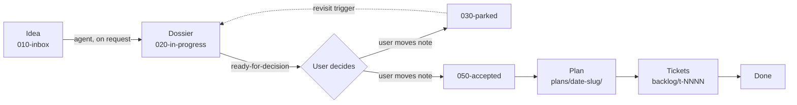

---
aliases:
  - "Workflow"
  - "Funnel"
  - "How we work"
tags:
  - tinygui
  - process
type: hub
updated: 2026-11-10
---

# Workflow

How an idea becomes done work in TinyGUI, for humans and agents. Home: [[index]].

| Stage | Folder | Index | Status |
|---|---|---|---|
| Idea | `ideas/010-inbox/` | [[inbox]] | `inbox` |
| Dossier | `ideas/020-in-progress/` | [[in-progress]] | `in-progress`, then `ready-for-decision` |
| Parked | `ideas/030-parked/` | [[parked]] | `parked` |
| Accepted | `ideas/050-accepted/` | [[accepted]] | `accepted` |
| Plan | `plans/<date>-<slug>/` | [[plans]] | `draft`, `active`, `done` |
| Ticket | `backlog/` | [[backlog]] | `backlog` … `done` |

## For humans

1. **Capture:** new note from [[idea]] in `ideas/010-inbox/` as `<YYYY-MM-DD>-<slug>.md`; one rough paragraph is enough. List it in [[inbox]].
2. **Ask** an agent to "process inbox" (or a named idea) when you want it researched.
3. **Read the dossier** when the idea reaches `ready-for-decision`: recommendation and questions first, then options, the knowledge map, validation.
4. **Decide** by moving the note: to `ideas/030-parked/` (set `status: parked`, `decision: parked`, `decided:`, and one line on why plus a revisit trigger) or to `ideas/050-accepted/` (`status: accepted`, `decision: accepted`, `decided:`). Moving the note is the decision.

## For agents

1. **Only the user parks or accepts.** Never move a note into `030-parked/` or `050-accepted/`, never set those statuses.
2. **Pick up ideas only when asked**, one at a time, oldest first. Move the note to `ideas/020-in-progress/` (same file name), set `status: in-progress`, update both index notes.
3. **Research** in `research/<idea-name>-research.md` from [[research-note]]: sources with URLs and dates, comparable work, prior art in this vault. Link it from the idea's `research:` property. Unconfirmed claims get #verify.
4. **Dossier:** append the sections of [[idea-dossier]] to the idea note: problem, value, assumptions, **knowledge map** (mandatory, below), validation, options including "do nothing", effort and risk, recommendation, questions for the user.
5. **Hand over:** set `status: ready-for-decision` and give a short chat summary with every open `critical` discovery item.
6. **No implementation before acceptance**, not even a spike in the repo.
7. **After acceptance:** create `plans/<date>-<slug>/<date>-<slug>.md` from [[plan]] (date = `decided:`), link idea and plan both ways, write ADRs from [[adr]] for real decisions, carry the knowledge map over, split milestones into tickets from [[ticket]] and list the plan in [[plans]] and [[accepted]].

## Knowledge map

Four quadrants (KK / KU / UK / UU). Every dossier and plan lists its items in [[discovery]] per quadrant:

| Quadrant | Ask |
|---|---|
| Known knowns | What do we know, and what is the evidence? |
| Known unknowns | What must we find out before deciding or building? |
| Unknown knowns | What are we assuming without saying so? What would have to be true? |
| Unknown unknowns | Pre-mortem: it failed six months later; why? |

An empty quadrant needs a sentence saying what was tried. Items that block a milestone become `spike` tickets.

## Tickets

- **Implementation starts from a ticket** in [[backlog]]. No ticket: create one for agreed work from [[ticket]] (next free `t-NNNN`) or ask.
- Start: `status: in-progress`, `assignee`, a dated log line. Finish: tick the criteria, paste verification evidence (command and result) into the log, `status: done`, `closed:`.
- Never close a ticket without evidence.

## Properties

Every note starts with frontmatter. Common properties:

| Property | Meaning |
|---|---|
| `aliases` | other names the note is found by |
| `tags` | always includes `tinygui`, plus the note's area |
| `type` | `hub`, `index`, `idea`, `plan`, `ticket`, `discovery`, `adr`, `research`, `reference` (as-built documentation: architecture, examples, analysis) |
| `status` | per type: idea `inbox\|in-progress\|ready-for-decision\|parked\|accepted`; plan `draft\|active\|done`; ticket `backlog\|todo\|in-progress\|review\|done\|blocked\|cancelled`; discovery `open\|researching\|answered\|obsolete`; ADR `proposed\|accepted\|superseded` |
| `created` | `YYYY-MM-DD`, set once |
| `updated` | `YYYY-MM-DD`, on every meaningful edit |
| `revision` | `reference` notes: the git commit their `file:line` citations refer to |
| `owner` / `assignee` | `user` or `agent` (or a name) |
| `decision`, `decided` | set by the user on park or accept |
| `idea`, `plan`, `research` | wikilinks between the stages |

## Naming and links

- Note names are unique across the vault, kebab-case: ideas `<YYYY-MM-DD>-<slug>`, tickets `t-NNNN-<slug>`, discovery items `d-NNNN-<slug>`, ADRs `NNNN-<slug>`, research `<slug>-research`. Numbers are never reused; names never change when a note moves.
- Notes in a plan folder carry the plan's slug as prefix.
- Wikilinks only (`[[note]]`, `[[note#Heading]]`, `[[note|label]]`), no Markdown links between notes. Whoever moves a note updates the index notes.

## #verify

`#verify` marks a claim without evidence yet (a measurement, a source, a test). Remove the tag when the evidence is linked; a `#verify` that matters for a decision becomes a [[discovery]] item.
